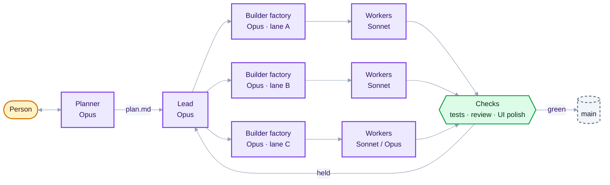

# Herdr Software Factory

A team of AI coding agents, run inside Herdr, that takes a software problem, plans it into milestones and tickets, and builds it **faster than one top-tier model working alone, at the same or better quality, for about the same money**.

This repo is a public build log: what we are trying, why, how it works, what the measurements say, and what broke along the way. The code will follow once the design settles.

## The goal in one line

> Same problem, same brief: the team finishes sooner than a solo Opus session (which may use its own subagents), matches or beats it on hidden tests, and any extra cost buys proportionally more speed.

Speed and quality rank equally first. Cost comes second: at most 15–20% above solo, and each 1% of extra cost must cut wall time by at least 2%.

## Read the posts

| # | Post | What it covers |
|---|---|---|
| 1 | [Why build a software factory](docs/01-why.md) | The problem, the aims, why a team instead of one agent |
| 2 | [How it works](docs/02-how-it-works.md) | Roles, models, lanes, worktrees, the batch loop, checks, holds |
| 3 | [What we have done so far](docs/03-progress.md) | Ten benchmarks, the numbers, what each one taught us |
| 4 | [Post-mortem: the run that stalled](docs/04-bench10-postmortem.md) | A real-world run that lost 30 minutes to the harness, and why |
| 5 | [Where it goes next](docs/05-roadmap.md) | The harness rebuild, swarm ideas, making it reproducible |
| 6 | [Builders, workers and parallelism](docs/06-builders-workers-parallelism.md) | How builders and their workers split the work, why warm workers are cheaper, where the speed comes from, and how the swarm features fit in |

## Status

| | |
|---|---|
| Benchmarks run | 10 (bench1–bench10) |
| Best result so far | bench9: team 19–64% faster than solo across four runs, 89/89 hidden tests on both sides |
| Latest | bench10, the first real-world-style run (existing repo, product brief, mid-run change request): solo won; the team stalled on harness faults |
| Now | Harness rebuilt so no check can silently stop work, plus swarm features (64 harness tests); next, a bench10 rerun |

## Built on

- **Herdr**: a desktop app for running many terminal agents side by side, with mods (UI panels) and layouts.
- **hc** (herdr-core): the command-line tool agents use to start, message, read and wait on each other's terminals.
- **Claude Code** sessions as every agent on the team, on Opus, Sonnet or Haiku depending on the job.

## Licence

MIT. See [LICENSE](LICENSE).
