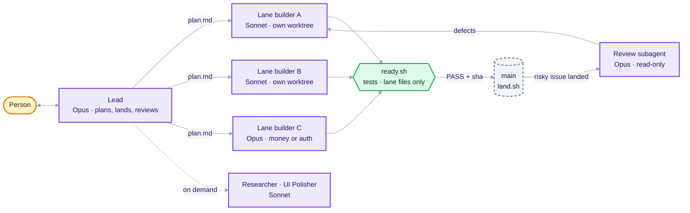

# Herdr Software Factory

A team of AI coding agents, run inside Herdr, that takes a software problem, plans it into milestones and tickets, and builds it **faster than one top-tier model working alone, at the same or better quality, for about the same money**.

This repo is a public build log and, from post 8 on, the code: what we are trying, why, how it works, what the measurements say, what broke, and the packages to run it yourself.



## The goal in one line

> Same problem, same brief: the team finishes sooner than a solo Opus session (which may use its own subagents), matches or beats it on hidden tests, and any extra cost buys proportionally more speed.

Speed and quality rank equally first. Cost comes second: at most 15% above solo (a hard cap), and each 1% of extra cost must cut wall time by at least 2%.

## Install

You need Herdr with `herdr-app` and `hc` on your PATH, Claude Code (`claude`), Node 20 or newer, and git.

One line, if you are happy to run the script without reading it first:

```sh
curl -fsSL https://raw.githubusercontent.com/esharif20/herdr-software-factory/main/install.sh | sh
curl -fsSL https://raw.githubusercontent.com/esharif20/herdr-software-factory/main/install.sh | sh -s -- --tsf --skills   # pick packages
```

Or clone it and read `install.sh` first (about 60 lines):

```sh
git clone https://github.com/esharif20/herdr-software-factory
cd herdr-software-factory
./install.sh            # all four packages
./install.sh --tsf      # or pick: --team --tsf --ui --skills
```

The curl line clones the repo to `~/.herdr-software-factory/src` and runs the same script. It copies each package into place and runs `herdr-app check` on the mods. Anything it replaces moves to `~/.herdr-software-factory/backups/<time>/` first. Then restart Herdr, open the team layout, and describe the work to the Lead in your project.

### Through Herdr

The two mods are also laid out the way Herdr shares mods, in [`herdr/`](herdr): a `mods/<name>/` folder, a `RECIPE.md` and a `preview.png` each. Ask the agent in your Herdr window to "add the mod at github.com/esharif20/herdr-software-factory/tree/main/herdr/herdr-team". It reads the recipe and every file, tells you what the mod runs and reaches, then copies it in. The tsf skill and skill packs still come from `./install.sh --tsf --skills`.

## Packages

| Package | Installs to | What it does |
|---|---|---|
| [`herdr-team`](herdr/herdr-team) | `~/.config/herdr-app/mods/orchestration` | The team: a Lead (Opus) that plans with you and splits work into file-disjoint lanes, lane builders (Sonnet by default, Opus for money, security, data deletion or hard logic) each in its own git worktree, and an on-demand Researcher and UI Polisher. The `harness/` scripts do the checks without spending tokens: `ready.sh` and `land.sh` (hand-off by exact commit, merge, tests, undo on red), `status.sh` (free, stalled and review-due lanes), `capacity.sh` (lane cap from free RAM), `graph/auto.sh` (builds a Graphify code map on repos over 400 KB of source), and `skills/skills.mjs` (which of your skills each lane reads). |
| [`tsf`](packages/tsf) | `~/.claude/skills/tsf` | The Lead's planning playbook, read right before it writes `.tsf/plan.md`: how many lanes, which issues go together, which skills each lane gets, when a lane earns an Opus seat, which issues get a review. Also the `/tsf init`, `plan`, `batch` and `status` commands. |
| [`factory-team-view`](herdr/factory-team-view) | over `~/.config/herdr-app/mods/factory` | Team and Skills tabs added to munza's [Factory](https://github.com/munza/herdr-mods) mod (Apache-2.0): the live lane team, each lane's builder, issue and skills, and a Skills tab to add or remove skills per group or per lane. Install Factory first; `--ui` applies our patch only if it fits your Factory version. |
| [`skill-packs`](packages/skill-packs) | `~/.claude/skills/<name>` | Fetches the third-party skills the team uses from their upstream repos at pinned commits: rstack's six (new-feature, code-structure, unslop, before-and-after, evidence-driven-testing, greploop), the planning and review skills (grilling, domain-modeling, codebase-design, tdd, diagnosing-bugs, code-review) and the DESIGN.md library. See its README for sources, licences and our local patches. |

## How a run goes

1. **Plan with you.** The Lead uses grilling, domain-modeling and codebase-design to write `docs/ARCHITECTURE.md`, `GLOSSARY.md` and milestones of issues. It starts no builder until you agree.
2. **Split.** It reads `tsf`, then writes `.tsf/plan.md`: one line per lane with its issues, the files each lane owns, the shared contract, a code map, `structure:` and `prose:` rules (from code-structure and unslop), and `skills <lane>:` lines.
3. **Build.** Every lane starts in one turn, each in `.tsf/lanes/<lane>` on branch `lane/<lane>`. Builders commit per issue, never touch main, and finish with `ready.sh`.
4. **Land and review.** The Lead lands each lane by its exact commit. The riskiest three issues get a read-only Opus review once they land, and its findings go back to the builder as failing tests.
5. **Finish.** `finish.sh` runs the full tests on main and prunes the lane branches and worktrees.

## Read the posts

| # | Post | What it covers |
|---|---|---|
| 1 | [Why build a software factory](docs/01-why.md) | The problem, the aims, why a team instead of one agent |
| 2 | [How it works](docs/02-how-it-works.md) | Roles, models, lanes, worktrees, the batch loop, checks, holds |
| 3 | [What we have done so far](docs/03-progress.md) | Ten benchmarks, the numbers, what each one taught us |
| 4 | [Post-mortem: the run that stalled](docs/04-bench10-postmortem.md) | A real-world run that lost 30 minutes to the harness, and why |
| 5 | [Where it goes next](docs/05-roadmap.md) | The harness rebuild, swarm ideas, making it reproducible |
| 6 | [Builders, workers and parallelism](docs/06-builders-workers-parallelism.md) | How builders and their workers split the work, why warm workers are cheaper, where the speed comes from, and how the swarm features fit in |
| 7 | [Speed, quality and cost](docs/07-speed-quality-cost.md) | How each is protected, context engineering, what builders do differently, workers vs plain subagents, and where Graphify fits |
| 8 | [The MVP: lane teams, skills, and the packages](docs/08-mvp.md) | The lean team that beat solo on all three benches, the skills system, what cost too much, and how to install it |

## Status

| Bench | What it is | Time vs solo | Cost vs solo | Hidden tests (team / solo) |
|---|---|---|---|---|
| bench10 | One feature in an existing app, with a mid-run change | −61% | −14% | 203 / 203 of 205 |
| bench11 | Three milestones of GitHub-style issues, an urgent bug and a change mid-run | −36% | −24% | 172 / 171 of 172 |
| bench12 | Two milestones on a Python service, an urgent bug mid-run | −42% | +8% | 140 / 140 of 140 |

Solo is one Opus session with full settings: all skills, plugins and subagents. MVP reached: the team beats it by at least 30% on all three, at equal or better quality and inside the cost cap.

## Built on

- **Herdr**: a desktop app for running many terminal agents side by side, with mods (UI panels) and layouts.
- **hc** (herdr-core): the command-line tool agents use to start, message, read and wait on each other's terminals.
- **Claude Code** sessions as every agent on the team, on Opus, Sonnet or Haiku depending on the job.
- **Skills** from [rstack](https://github.com/michaelshimeles/rstack), Matt Pocock's skills, and [awesome-design-md](https://github.com/VoltAgent/awesome-design-md). Sources and licences are in `packages/skill-packs`.

## Licence

MIT. See [LICENSE](LICENSE).
