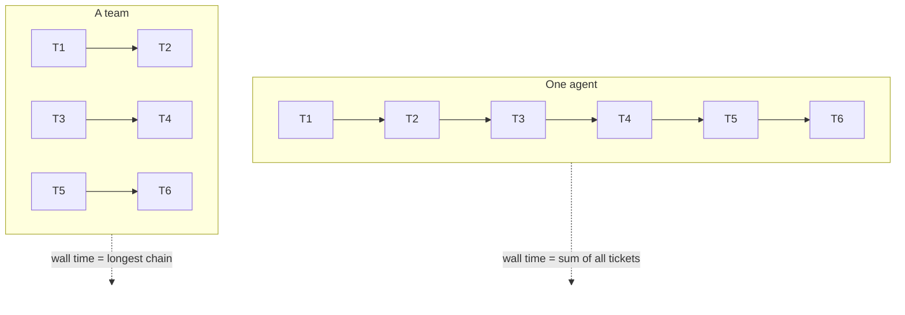

# 1. Why build a software factory

## The problem

One strong coding agent, such as Claude Opus in Claude Code, can already build a real feature end to end. It plans, writes code, runs tests and fixes what fails. It even starts helpers (subagents) for side tasks.

But it works **one thing at a time**. A feature with twenty tickets is built roughly one ticket after another, inside one ever-growing context window. Every turn re-sends that whole context, so the work gets slower and dearer the longer it runs, and the most expensive model spends most of its time on routine code.

## The idea

Software companies solved this long ago: split the work, give each piece to the right person, run the pieces at the same time, and check the results.

We want the same thing with agents:

- **Plan once, well.** A planner turns the brief into milestones and tickets with exact file scopes and interfaces.
- **Build in parallel.** Independent areas go to separate builders, each in its own git worktree, so they never step on each other.
- **Use the right model for each job.** The expensive model defines the work; a cheaper model, given an exact brief, builds it. Opus defines, Sonnet executes.
- **Keep every context small.** Each agent sees only its ticket, its brief and the files it needs, so it starts fast and stays cheap.
- **Check everything automatically.** Tests, reviews and UI polish run without a human in the loop, and only real decisions reach the lead.

Wall time for one agent is roughly the sum of every ticket. For a team it is the **longest chain of dependent tickets**, plus planning and merging. That gap is the whole opportunity.

## The aims

| Aim | Target |
|---|---|
| Speed | Finish sooner than a solo Opus session that may use its own subagents |
| Quality | Equal or better on hidden tests the agents never see, plus code a person is glad to read |
| Cost | At most 15–20% above solo, and only if it buys speed: each 1% of extra cost must cut wall time by at least 2%. Cheaper is a bonus |
| Flexibility | Works on any real job: new features, bug fixes, refactors, other languages, not tuned to one benchmark |
| Autonomy | Runs from brief to merged code on its own; problems go to the lead, which decides, and the run continues |
| Visibility | Every agent is a visible, steerable terminal; the plan, tickets, costs and progress show live in the UI |

## Why not just use subagents?

Subagents live inside one parent session. They are hidden, they report only a final answer, they cannot be steered mid-task, and they end when they answer.

Team members here are **separate, long-lived Claude Code sessions** in their own terminals. A person or the lead can read their screen, send them a message, interrupt them, or hand them the next related ticket while they still remember the code. That last point, a "warm" worker, is a large part of why the team can be cheaper than solo.

## Why benchmarks, and why not tune to them

We measure with benchmarks: the same brief goes to a solo Opus session and to the team at the same moment, and hidden tests score both builds. That is the only honest way to know whether the team helps.

But a benchmark is a tool for finding general faults, not a target. The factory must work on real projects. When a benchmark exposes a fault, we fix the general cause, never the benchmark's special case. Post 4 shows why this matters.
