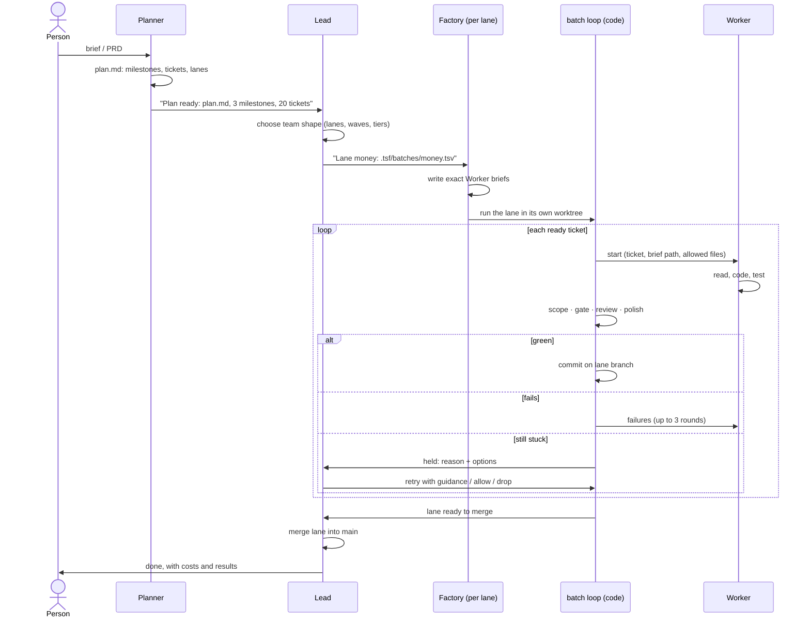
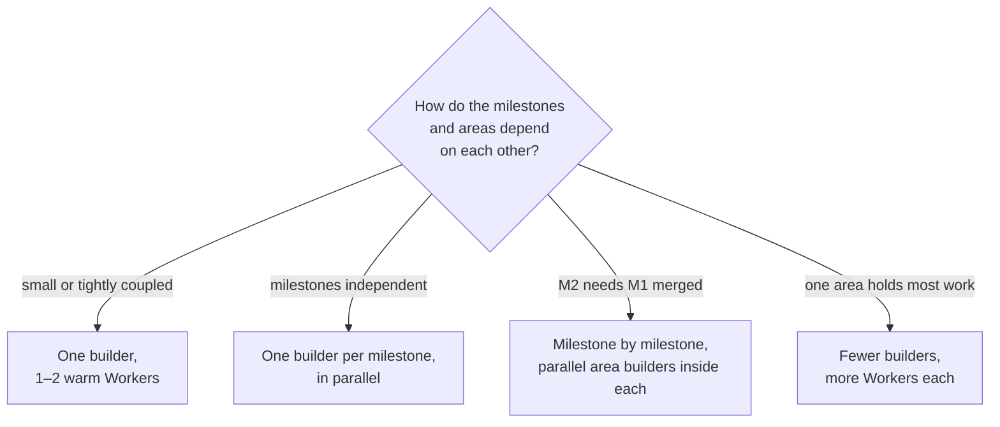
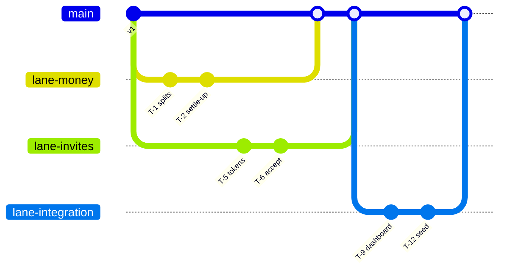
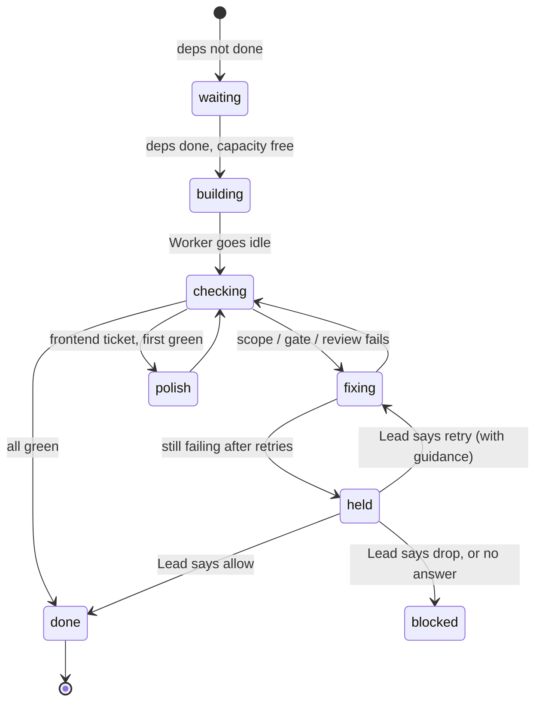

# 2. How it works

## The roles

| Seat | Model | Job | Not its job |
|---|---|---|---|
| **Planner** | Opus | Talks with the person, turns the brief into `plan.md`: milestones, tickets, file scopes, dependencies, a lane proposal | Building |
| **Lead** | Opus | Reads the plan, picks the team's shape, starts the builders, answers held tickets, merges each lane, reports to the person | Writing feature code |
| **Builder factory** | Opus (medium effort) | Owns one lane. Turns the plan's tickets into exact Worker briefs, then runs its lane with the batch loop | Feature code beyond small fixes |
| **Worker** | Sonnet by default; Opus for hard rows; Haiku for trivial ones | Builds one ticket from its brief, with its own targeted tests | Anything outside its file scope |
| **Reviewer** | Opus | For logic that must be right: writes adversarial tests during the build, then reviews the diff | Building |
| **UI Polisher** | Sonnet | One pass over every new screen: states, spacing, alignment, accessibility | First designs |
| **Test writer** | Sonnet | Writes hidden gate tests from the spec before the build, for gated tickets | Building |

**Opus defines, Sonnet executes.** The planner and the factories write the exact briefs; Sonnet Workers, given those briefs, build them well and at a fraction of the price.

For a closer look at builders, workers and how the work runs in parallel, see [post 6](06-builders-workers-parallelism.md).

## The flow

## The team's shape is a decision, not a fixed rule

The lead picks the smallest team that is fastest for this job, from the plan's milestones:

Up to five builders, limited by free memory. A builder or Worker is added only where it shortens the longest chain: each fresh session costs about a minute and some dollars of re-reading the code.

## Lanes, worktrees and merges

Each builder's lane runs in its **own git worktree on its own branch**, so lanes never see each other's half-written files.

- Each finished ticket is committed on its lane branch.
- Lanes build against the plan's **contract** (agreed interfaces), so they rarely wait on each other.
- Work that joins areas (dashboards, seed data, CLI wiring) goes in an **integration lane** that starts once the area lanes it needs are merged.
- The lead merges each lane as soon as it reports. A conflict goes back to that lane: a Worker merges `main` in, fixes the conflict, reruns tests, and the lead merges again.

## The batch loop

The repetitive part, starting Workers, waiting, testing, retrying, is **plain code** (`batch.mjs`), not an agent. It spends no tokens, which is a big reason the team can cost less than solo.

**Checks, in order**

1. **Scope**: did the Worker write only its allowed files? Only files the Worker's own session wrote count, read from its transcript, so another agent's edits are never blamed on it.
2. **Gate**: do the hidden tests from the Test writer pass? Without a Test writer, the Worker's own tests are the gate.
3. **Review**: for logic that must be right, a Reviewer writes adversarial tests during the build and reviews the diff. Defects go back to the same Worker.
4. **UI polish**: one Polisher pass on each new screen.

**Retries**: failures go back to the same, still-open Worker; the third failure gets a fresh session from a handoff note; then the ticket is **held** and the lead decides.

## Nothing fails silently

Every problem reaches the lead as a short message with options: a failed check, a missing test, a stalled dependency, a dead session, a merge conflict. The lead answers, often several at once, and the run carries on. The lead also gets a short digest of progress about once a minute, never a message per event, because every message re-sends the lead's whole context.

## Context engineering, for cost

- **Lean seats**: Workers start with ~11k tokens of instructions instead of ~60k; no plugins or global rules, only the skills a brief names.
- **Pointers, not pasted text**: briefs name file paths and contract sections; agents read line ranges.
- **Warm Workers**: a chain of tickets on one module goes to the Worker that just built the previous one.
- **Files, not messages**: long answers are written to files and sent as paths.
- **The lead reads the plan's headings**, never the whole brief.

## What you see

Herdr shows every agent as a terminal. A **Team** view puts the lead and planner on the left and the builders on the right. An **Ops** panel shows each lane's tickets live, with stage, model, time and cost, plus parallelism and cost by model.
