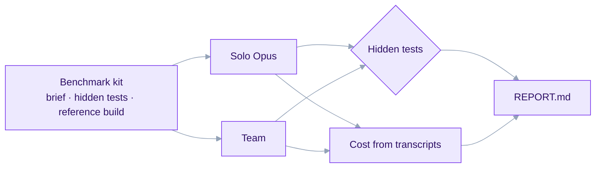

# 3. What we have done so far

## How we measure

Every benchmark gives the **same brief to both sides at the same moment**:

- **Solo**: one Claude Code session on Opus at high effort. It may use built-in subagents.
- **Team**: the Herdr team (planner, lead, builders, workers, reviewer, UI polisher).

Then we compare:

- **Time**: from the start until each side writes its done file.
- **Cost**: read from every session's transcript (including subagents) at list prices.
- **Quality**: a hidden test suite neither side ever sees, plus each side's own adversarial tests run against the other side's build, plus a person reading both apps.

Each kit is checked before a run: the hidden tests must all pass on a reference build, fail on a deliberately broken copy, and mostly fail on the starting code.

## The journey

| Bench | What changed in the team | Solo | Team | Result |
|---|---|---|---|---|
| 1–3 | First teams; parallel Sonnet Workers with complete specs | | | Parallel Sonnet Workers beat solo Opus on speed and cost, tests tied. The lead became the largest cost |
| 4–7 | A code-owned batch loop replaces lead turns; gate caps, fresh session on the third failure, protected files, budgets per role | | | Fewer lead turns; a too-tight budget blocked a finished ticket (fixed) |
| 8 | Lean seats (~11k start tokens instead of ~60k) | 620 s · $5.36 | 406 s · $5.55 | **35% faster**, 4% dearer |
| 9 run 1 | Builder factories, one per lane | 1037 s · $5.97 | 380 s · $6.34 | **63% faster**, but lanes flagged each other's files |
| 9 run 2 | Lane scope fixed | | 582 s · $5.43 | |
| 9 run 3 | Review folded into the build | | 529 s · $4.21 | **29% cheaper** than solo run 1 |
| 9 run 4 | Double UI polish removed; solo rerun for fairness | 605 s · $5.19 | 492 s · $4.87 | **19% faster, 6% cheaper**; every stage of the pipeline worked |
| 10 run 1 | First real-world-style run | 1159 s | stopped at ~48 min | **Solo won.** The team stalled on harness faults (post 4) |

Every bench9 run scored **89/89** hidden tests on both sides. In run 4 the team's 94 adversarial tests passed against solo's build, and solo's 16 passed against the team's.

## What bench10 changed

Earlier benchmarks started from an empty folder with tickets already cut. Bench10 starts the way real work does:

- **An existing codebase**: a v1 app already in git, with tests, a README and a few commits.
- **A product brief, not tickets**: both sides plan for themselves, and planning time counts.
- **A change request mid-project**: at six minutes, both sides receive the same change from the product owner.
- **Regression**: every v1 feature must still work.
- **Human review**: both apps are seeded with demo data and served, so a person can compare them by eye.

The kit: 205 hidden tests (33 regression, 150 for v2, 22 for the change request). A reference build passes all 205; a copy with six planted defects (two each in money, signed tokens and chore rotation) fails 25.

Neither side is told it is a benchmark, and each works in a separate folder away from the hidden tests.

## What we learned

1. **Parallelism pays when the plan is good.** The team's wall time tracks its longest chain of tickets, not the total work.
2. **The lead's context is the dearest thing on the team.** Every message to it re-sends everything it has read. Moving loops into plain code and keeping its turns few made the biggest cost difference.
3. **Lean, warm sessions are cheap sessions.** Starting a session with a small prompt and reusing it for the next related ticket beats a fresh session that re-reads the code.
4. **Tidy benchmarks hide real faults.** Bench9 looked solved. Bench10, with a live codebase and a change request, showed a harness that was too strict and too silent (post 4).
