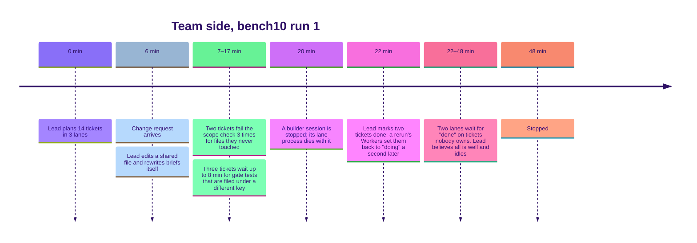

# 4. Post-mortem: the run that stalled

Bench10 was the first run that looked like real work: an existing repo, a product brief instead of tickets, and a change request at minute six. Solo Opus finished in **19 minutes 19 seconds**. The team was stopped at about **48 minutes**, with 10 of 14 tickets done and two lanes stuck.

None of that time was lost to bad code. It was lost to the **harness**, the rules and loop that run the team.

## What went wrong, in plain words

1. **Workers were blamed for the lead's edits.** All builders shared one folder. When the change request came in, the lead edited a file itself. The scope check saw a changed file outside each Worker's allowed list, assumed the Worker did it, made it "fix" it three times, then blocked the ticket.
2. **It waited for tests that were filed in the wrong place.** The Test writer saved gate tests under one key; the batch loop looked under another. It waited up to eight minutes per ticket, then blocked.
3. **A stopped builder took its lane down.** The lane's loop ran as a child of the builder's session, so stopping the builder killed the loop. Its Workers kept running, unsupervised.
4. **Ghost tickets.** Workers were told to move their own ticket to "doing". A rerun's Workers did so one second after the lead had marked those tickets done, and then their loop died. The tickets stayed "doing" with no owner.
5. **A silent deadlock.** Two other lanes waited for those ghost tickets. Nothing told the lead, which thought the work was finished.
6. **A harmful instruction.** A Worker had copied a file somewhere temporary; the scope check counted that as writing it and told it to "revert those files". It deleted the product owner's change request.

## Why it happened

The harness was built and tuned on tidy benchmarks: tickets cut in advance, a quiet folder, every role present, nobody editing mid-run. Real work breaks every one of those assumptions.

So the harness treated each surprise as "the Worker failed, stop it", when it should have **asked the lead**. It was strict where it should have been flexible, and silent where it should have spoken up.

## The fixes

| Fault | Fix |
|---|---|
| Blamed for others' edits | A Worker is checked only against files its own session wrote, read from its transcript |
| Checks that kill work | A failed check **holds** the ticket: the Worker stays open, the lead gets the reason and answers *retry with guidance*, *allow* or *drop* |
| Tests not found | The gate looks under both keys; if tests truly never come, the ticket is held with "allow on the Worker's own tests" as an option |
| Lane dies with its builder | Each lane runs as its own process with a lock, a heartbeat and a clean shutdown that puts its tickets back in the queue |
| Ghost tickets | Only the loop moves tickets; a "done" ticket can't be moved back |
| Silent stalls | A wait on a ticket whose owner is gone alerts the lead within a minute |
| Shared folder | Each lane gets its own git worktree and branch; the lead merges and conflicts go back to the lane |
| Harmful instruction | "Undo only your own changes; never delete files you did not create" |
| A blind lead | The lead receives a short digest of events and can message or interrupt any agent directly |

Every one of these becomes a regression test, so the same fault cannot come back unnoticed.

## The lesson

A harness should give structure, speed and checks, and **never stop work silently**. Every problem should reach the one agent able to decide, with the options in hand. Then the run can heal itself without a person stepping in.
