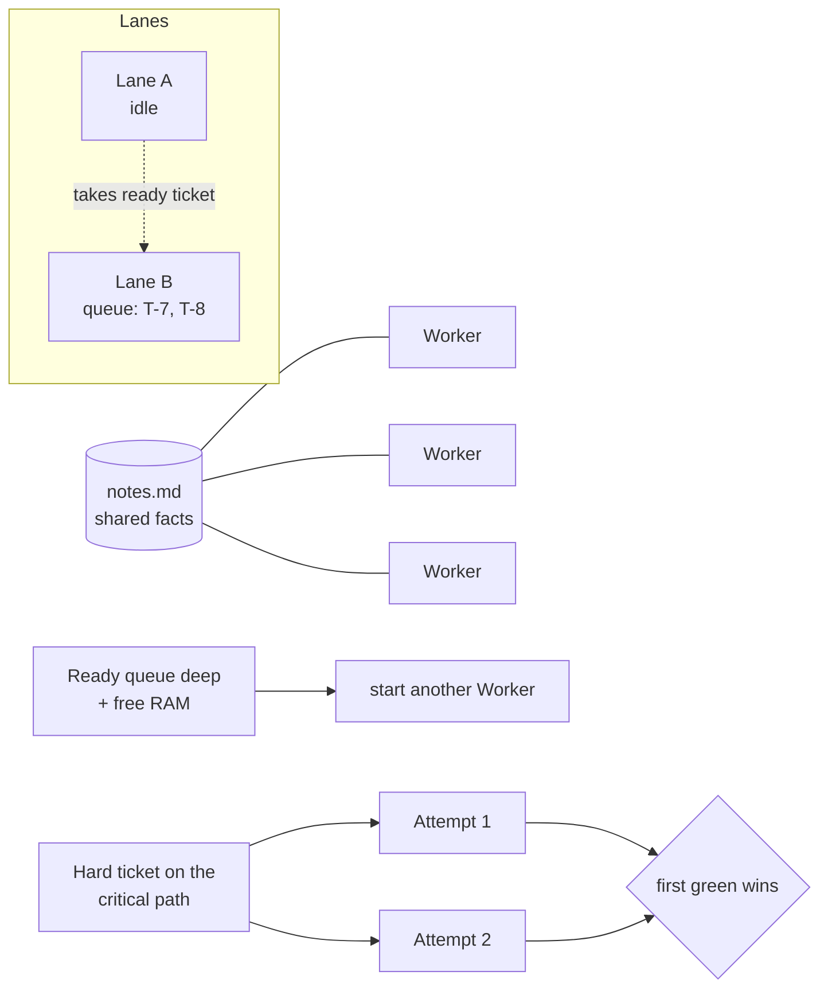
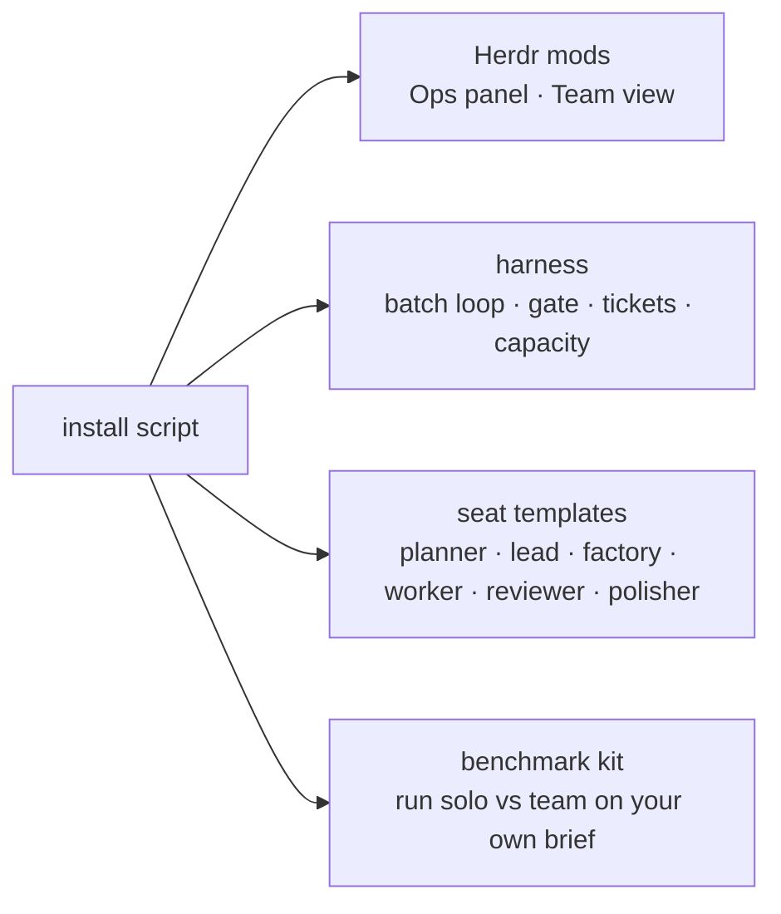

# 5. Where it goes next

## Now: the harness rebuild

Everything in [post 4](04-bench10-postmortem.md)'s fix table, plus:

- **The lead stays in the loop.** Progress digests, direct messages to any agent, and Workers that ask their builder when a brief is unclear.
- **Opus factories.** Each builder writes exact Worker briefs for its own lane, so brief-writing runs in parallel instead of one after another in the planner.
- **The planner hands over one line.** "Plan ready: plan.md, 3 milestones, 20 tickets, 3 lanes proposed." The lead reads headings, not the brief.
- **Reviews, UI polish and retries kept intact**, each with a test.

Then bench10 runs again. The bar: the team beats solo's 19:19 at the same hidden-test score, and costs less.

## Built: four ideas borrowed from swarms (see [post 6](06-builders-workers-parallelism.md))

The team stays a hierarchy (planner → lead → builders → workers) because that keeps contexts small and decisions accountable. But four swarm ideas fit:

1. **Work stealing**: an idle builder takes a ready ticket from another lane in the same milestone.
2. **A shared notes board**: Workers add one-line `file:line` facts as they find them, so others skip re-reading the code. Capped at about 50 lines.
3. **Elastic scaling**: start Workers when ready tickets pile up and memory allows; stop idle ones at once.
4. **Racing a hard ticket**: for a hard ticket on the longest chain only, two Sonnet Workers try in parallel and the first to pass wins.

They are in the harness now, each behind a setting. The bench10 rerun measures whether they earn their keep.

## Later: make it reproducible

The aim is that anyone with Herdr and Claude Code can install the factory and run it on their own project:

- One install script that copies the mods, harness and seat templates, and checks the prerequisites.
- Settings in one file (models per seat, budgets, how many builders), with sensible defaults.
- A benchmark kit so anyone can run solo against the team on their own brief and get the same report.
- Varied tests beyond bench10: a bug fix in an unfamiliar repo, a refactor, a project in another language.
