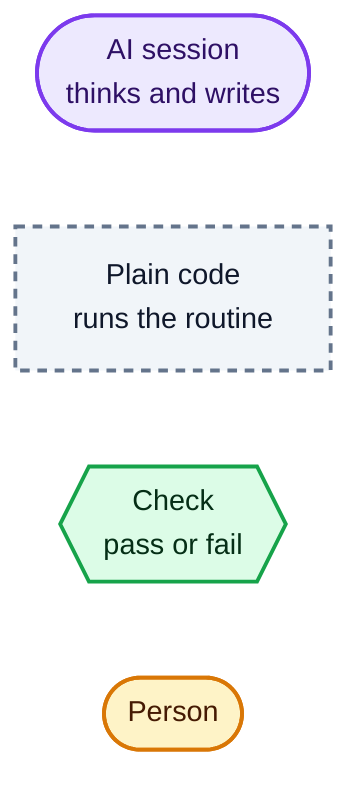
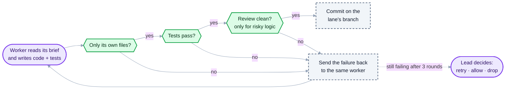
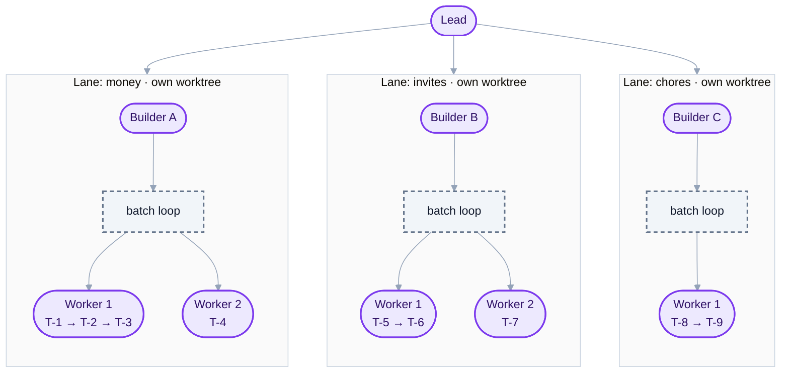
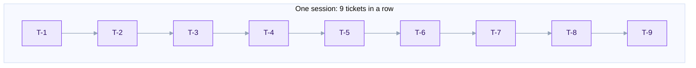
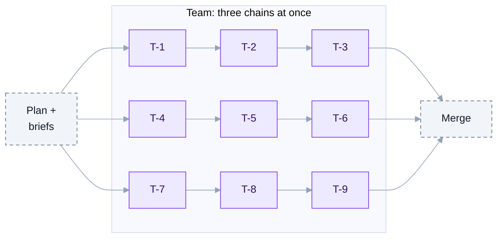

# 6. Builders, workers and parallelism

This post explains the two layers that do the building, **builders** and the **workers** inside them, how AI and plain code split the job, and where the speed comes from.

Colours in every diagram:



## AI does the thinking, code does the routine

Every agent on the team is an **AI session**: a Claude Code session that reads, decides and writes. AI is not deterministic. Ask it twice and you may get two different, both reasonable, pieces of code.

The **batch loop** is **plain code**. It never writes product code and never "decides" anything creative. It does the boring, repeatable part: start a worker, wait until it stops, then run yes/no checks. The same result always gets the same verdict.

Put together, the AI creates and the code judges, and they loop until every check passes:



### What the checks actually check

Plain code cannot understand whether code is "correct". It does not need to: the understanding is written down **in advance, as tests**, and the code only runs them and reads the result.

| Check | Who supplies the judgement | What the code does |
|---|---|---|
| **Scope** | The builder, who listed the files each ticket may write | Compares the files the worker changed against that list. A pure list comparison |
| **Gate tests** | A separate AI **Test writer**, which writes hidden tests from the spec *before* the build. The worker never sees them | Runs them and reads pass/fail |
| **The worker's own tests** | The worker, from its brief's edge cases | Runs them and reads pass/fail |
| **Review** (risky logic only) | An AI **Reviewer** (Opus) that writes adversarial tests and reads the diff | Runs its tests and checks whether its findings say "no defects" |
| **UI polish** (new screens) | An AI **UI Polisher** that improves the screen | Re-runs the checks above afterwards |

A concrete example. The spec says: *split $10.00 three ways; leftover cents go to the first people.* The Test writer turns that into:

```js
assert.deepEqual(split(1000, 3), [334, 333, 333]);
```

The worker writes `split()` without seeing that test. The batch loop runs the test: if the worker's code returns `[333, 333, 333]` and loses a cent, the test fails, and the failure goes back to the worker with the exact line.

So "correct" here means **"does what the spec says, as captured by tests written by someone other than the author"**. That is only as good as the tests, which is why risky logic also gets an Opus Reviewer, and why a person can still read and run both builds at the end.

The AI's output varies; **what gets accepted does not**, because tests decide. It is a developer and a CI pipeline working together. Running the loop in plain code also costs nothing: no tokens are spent on waiting, polling or re-running tests.

## Who is who

| Part | Kind | Model | What it does |
|---|---|---|---|
| Planner | AI | Opus | Turns the brief into milestones and tickets |
| Lead | AI | Opus | Picks the team's shape, starts builders, answers held tickets, merges |
| Builder | AI | Opus | Owns one lane: writes exact briefs for its tickets, answers its workers' questions |
| Batch loop | Code | none | Runs a builder's lane: starts workers, checks, retries, commits, reports |
| Worker | AI | Sonnet (Opus for hard tickets) | Builds one ticket from its brief |
| Reviewer, UI Polisher | AI | Opus, Sonnet | Second opinion on risky logic; polish on new screens |

## Two layers of parallelism



1. **Across builders.** Each builder owns a **lane**: one area of the product that barely touches the others. Lanes run at the same time, each in its own git worktree and branch, and build against the plan's agreed interfaces, so they rarely wait for each other.
2. **Inside a builder.** Its workers take the lane's tickets. Independent tickets run side by side. A **chain** of tickets on one module (T-1 → T-2 → T-3) goes to **one worker that stays open**, because it already knows that code.

## Why a worker that stays open is cheaper and faster

A brand-new session spends its first minute, and a real share of its cost, reading the code. A worker that just built T-1 already knows it, so T-2 starts straight away.

| Three tickets on one module | Reads of the code | Rough time |
|---|---|---|
| A new worker for each ticket | 3 | 3 × (1 min read + 2 min build) = **9 min** |
| One worker kept open | 1 | 1 min read + 3 × 2 min build = **7 min** |

## Where the speed comes from

One session does the tickets one after another. A team runs separate chains at the same time, so its wall time is the **longest chain**, plus a little planning before and merging after.





Nine tickets in a row versus three chains of three: roughly a third of the build time, plus planning and merging.

## How the lead picks the shape

More builders and workers are not always faster: every new session costs about a minute and some money reading code. The lead adds one only where it shortens the longest chain.

| The job looks like | Shape |
|---|---|
| Small, or every ticket touches the same files | One builder, 1–2 workers |
| Milestones that don't depend on each other | One builder per milestone, in parallel |
| Milestone 2 needs milestone 1 merged | Milestone by milestone, with parallel area builders inside each |
| One area holds most of the work | Fewer builders, more workers each |

**Cost rule:** the team may cost up to 15–20% more than one solo session, and only if that buys speed. Each 1% of extra cost must cut wall time by at least 2%, so a run costing 15% more must be at least 30% faster.

## How the swarm features fit in

The hierarchy stays the same. Four swarm ideas let the batch loops adapt while the work runs:

```mermaid
%%{init: {'theme':'base','themeVariables':{'fontFamily':'-apple-system, Segoe UI, Helvetica, sans-serif','fontSize':'15px','lineColor':'#94A3B8','clusterBkg':'#FAFAFA','clusterBorder':'#CBD5E1'}}}%%
flowchart TB
    subgraph S1[1 · Work stealing]
        direction LR
        X[Lane A: nothing ready]:::code -- "claims T-7" --> Y[Lane B: T-6, T-7 waiting]:::code
    end
    subgraph S2[2 · Shared notes]
        direction LR
        W1([Worker]):::ai -- "adds: src/money.mjs:40<br/>rounding lives here" --> N[(notes.md)]:::code
        N -- "read before code" --> W2([Next worker]):::ai
    end
    subgraph S3[3 · Elastic workers]
        direction LR
        Q[Many tickets ready<br/>+ memory free]:::code --> W3([start another worker]):::ai
    end
    subgraph S4[4 · Race a hard ticket]
        direction LR
        H[Hard ticket on the<br/>longest chain]:::code --> R1([Attempt 1]):::ai & R2([Attempt 2]):::ai
        R1 & R2 --> G{{first to pass wins}}:::check
    end
    classDef ai fill:#EDE9FE,stroke:#7C3AED,color:#2E1065,stroke-width:2px
    classDef code fill:#F1F5F9,stroke:#64748B,color:#0F172A,stroke-width:2px,stroke-dasharray:5 4
    classDef check fill:#DCFCE7,stroke:#16A34A,color:#052E16,stroke-width:2px
```



1. **Work stealing.** A lane with nothing ready claims a ready ticket from a busy lane in the same milestone and builds it in its own worktree. Claims are atomic, so two lanes never build the same ticket. The busy lane's later tickets merge that work before they start. An optional **floater** worker can help any lane.
2. **Shared notes.** Workers add one-line facts (`file:line`, what is there) as they learn them. The next worker reads the notes before reading code, so it skips what the first one already found. Capped at about 50 lines.
3. **Elastic workers.** When many tickets are ready and memory is free, a lane starts another worker mid-run. A worker with nothing next is closed at once.
4. **Racing a hard ticket.** Only for a hard ticket that decides the finish time, and only when the lead marks it: two workers try it in separate scratch worktrees, the first to pass every check wins, and the other is stopped. Both are paid for, so it is used rarely.

All four are code decisions inside the batch loop: no extra AI is spent deciding them, only on the workers they start.

## What never changes

- Every AI session is a visible terminal a person or the lead can read, message or interrupt.
- Every ticket passes the same checks before it is accepted.
- Every problem reaches the lead with options. Nothing stops silently.
