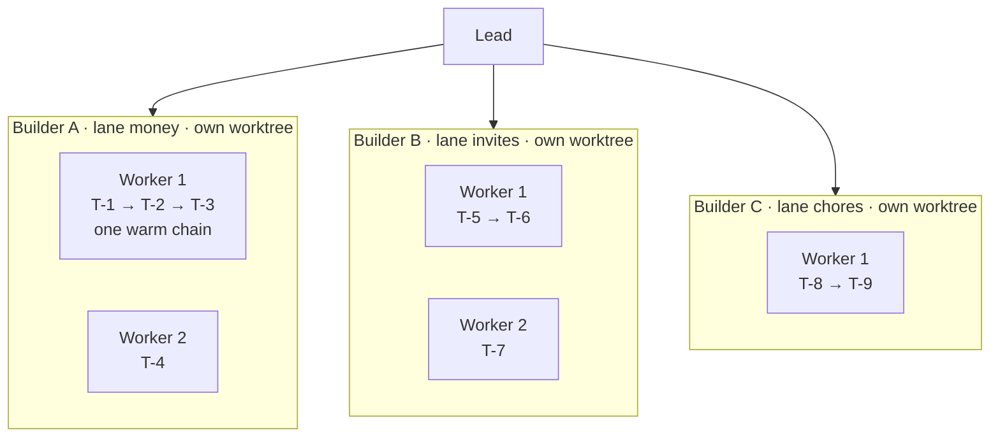
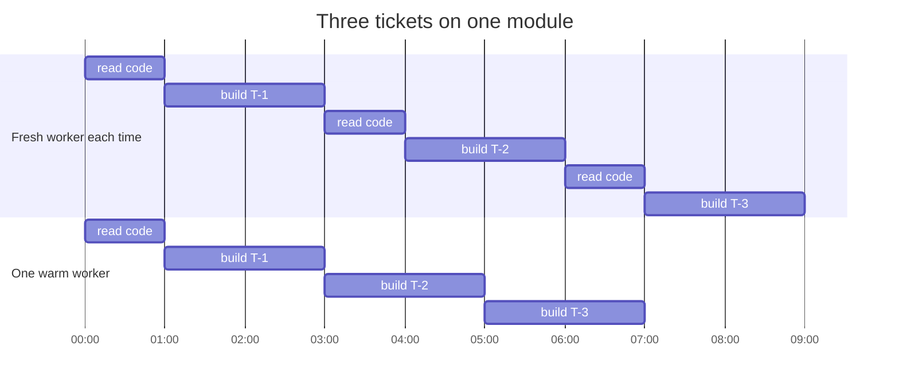
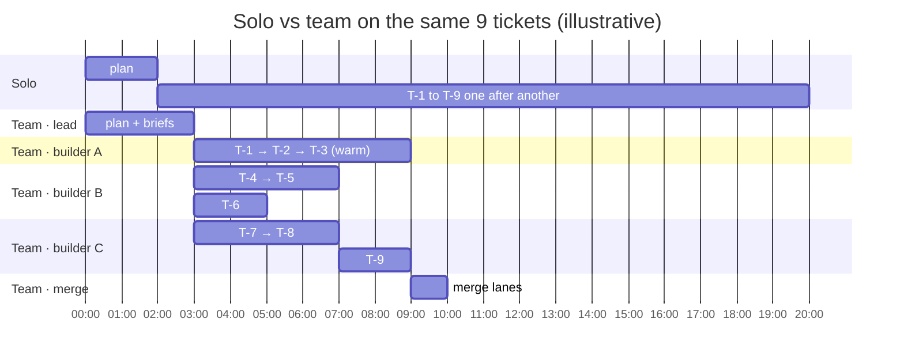
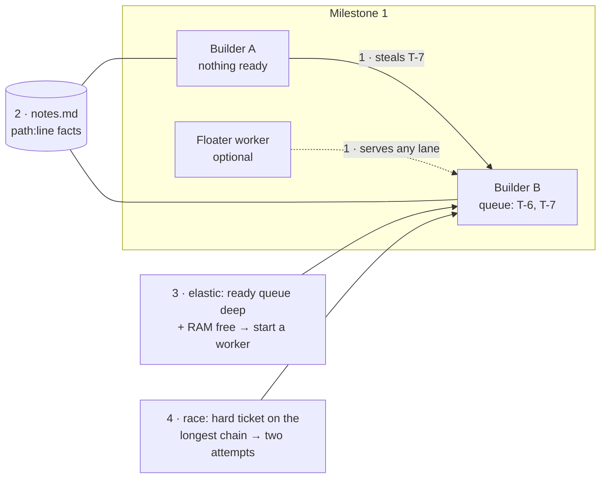
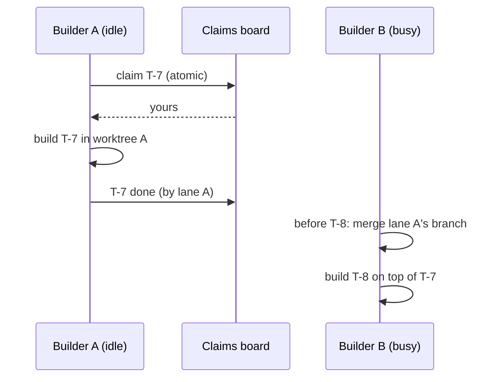

# 6. Builders, workers and parallelism

This post zooms in on the two layers that do the building, the **builders** and the **workers** inside them, and shows where the speed comes from.

## Two layers, two kinds of parallelism

- **Across builders**: each builder owns one **lane**, an area of the product that barely touches the others (money, invites, chores). Lanes run at the same time, each in its own git worktree and branch, and build against the plan's agreed interfaces, so they don't wait for each other.
- **Inside a builder**: its **workers** do related work in the same area. Independent tickets run side by side; a chain of tickets on one module (T-1 → T-2 → T-3) goes to **one warm worker** that already knows the code.

## What a builder does

A builder is an Opus session that owns its lane from start to merge:

1. **Writes exact briefs.** It turns each of its tickets into a brief a Sonnet worker can build without guessing: which files, which function signatures from the contract, the edge cases, the tests to write. Every builder does this for its own lane at the same time, so brief-writing is parallel too.
2. **Picks tiers.** Sonnet by default; Opus only for a ticket it can't specify down (a hard algorithm, security, concurrency); Haiku for trivial ones.
3. **Starts its lane** as its own process, the batch loop, which runs the workers, checks and retries without spending tokens.
4. **Answers its workers.** A worker with an unclear brief asks its builder one line; the builder wrote the brief, so it answers.
5. **Reports "ready to merge"** after merging `main` into its branch and running the lane's tests.

## What a worker does

A worker is a Claude Code session on its ticket's model, in its own visible terminal:

1. Reads its brief and the shared notes board.
2. Reads only the files and contract sections the brief points to, by line range.
3. Writes the code and its own targeted tests.
4. Stops. The batch loop then checks scope, gate tests, review and UI polish, and sends any failures back to the **same** worker.

When it finishes, it either takes the next ticket in its chain (staying warm) or is closed at once, so nothing idle is paid for.

## Why warm workers matter

A fresh session spends its first minute and a good share of its cost reading the code. A warm worker skips that.

Same work, two fewer reads: about two minutes and two re-reads of cost saved on a three-ticket chain.

## Where the speed comes from

Wall time is set by the **longest chain** of dependent tickets, not by the total amount of work.

The team pays a little more up front (planning, briefs) and a little at the end (merging), and saves everything in between by running chains side by side.

## How the lead decides the shape

More builders and workers are not always faster: each fresh session costs about a minute and some dollars of reading. So the lead adds one only where it shortens the longest chain.

| The job looks like | Shape |
|---|---|
| Small, or every ticket touches the same files | One builder, 1–2 warm workers |
| Milestones that don't depend on each other | One builder per milestone, in parallel |
| Milestone 2 needs milestone 1 merged | Milestone by milestone; parallel area builders inside each |
| One area holds most of the work | Fewer builders, more workers each |

**Cost rule:** the team may cost up to 15–20% more than one solo session, and only if that buys speed. Each 1% of extra cost must cut wall time by at least 2%, so a run costing 15% more must be at least 30% faster. A run near solo's cost must still be faster.

## How the swarm features fit in

The hierarchy stays: lead, builders, workers. Four swarm ideas make it adapt while it runs.

1. **Work stealing.** A builder with nothing ready takes a ready, unclaimed ticket from another live builder in the same milestone. It builds it in its own worktree; the owner's later tickets merge that branch before they start. A ticket is claimed atomically, so two builders never build the same one. An optional **floater** worker serves any lane.
2. **Shared notes board.** Workers add one-line facts as they find them, such as `src/money.mjs:40 largest-remainder rounding lives here`. Everyone reads it before reading code, so the second worker in an area skips what the first one learned. Capped at about 50 lines.
3. **Elastic scaling.** When ready tickets pile up and memory is free, a lane starts another worker mid-run; when a worker has nothing next, it is closed at once.
4. **Racing a hard ticket.** Only for a hard ticket on the longest chain, and only when the lead marks it: two workers build it in separate scratch worktrees, the first to pass all checks wins, and the other is stopped. Both are paid for, which is why it is used rarely.

## What never changes

- Every builder and worker is a visible, steerable terminal.
- Every ticket is checked (scope, tests, review for logic that must be right, UI polish for new screens).
- Every problem reaches the lead as a held ticket or an alert, with options. Nothing stops silently.
