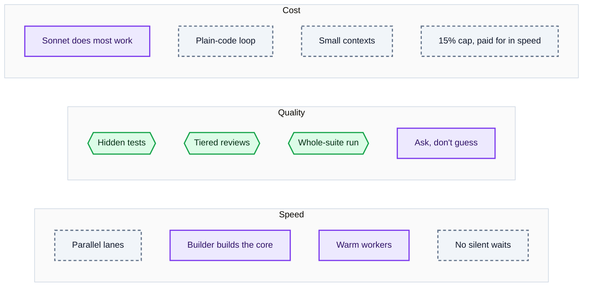
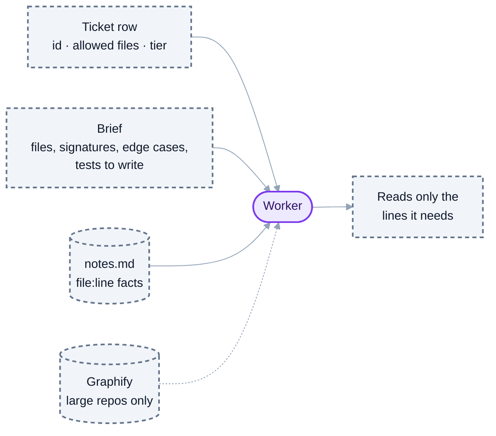

# 7. Speed, quality and cost: how each is protected

This post answers the questions people ask most: how the team stays fast, how quality is kept, how cost is controlled, what "context engineering" means here, what is different about builders, why workers instead of plain subagents, and where Graphify fits.

Colours as in post 6: purple is an AI session, grey dashed is plain code, green is a check.

## How speed is ensured

| Lever | What it does |
|---|---|
| **Parallel lanes** | Separate areas of the product are built at the same time, each in its own git worktree. Wall time becomes the longest chain of tickets, not the total |
| **The builder builds the core** | Each lane's Opus builder writes its workers' briefs, starts them, then builds the hard core ticket itself, already knowing that code |
| **Warm workers** | A chain of tickets on one module goes to the worker that just built the previous one, skipping a minute of re-reading per ticket |
| **Contract first** | Lanes build against the plan's agreed interfaces, so they rarely wait for each other's code |
| **Work stealing and elastic workers** | An idle lane takes a ready ticket from a busy one; a lane adds a worker when tickets pile up |
| **No silent waits** | A failing check holds the ticket and asks immediately; a stalled dependency alerts the lead within a minute |
| **Right-sized team** | The lead adds a builder or worker only where it shortens the longest chain. A worker is started only for a piece of 5+ minutes that the builder can run alongside its own work |

## How quality is ensured

| Check | Who judges | When |
|---|---|---|
| **Scope** | The builder's list of allowed files | Every ticket |
| **Hidden gate tests** | A separate Test writer, from the spec, before the build; the worker never sees them | Gated tickets |
| **The worker's own tests** | The worker, from its brief's edge cases | Every ticket |
| **Light review** | One Sonnet pass over the diff | Ordinary endpoints, UI logic, CLI |
| **Full review** | An Opus Reviewer writing adversarial tests during the build, then reviewing the diff; optionally a Codex Reviewer for a second model's eyes | Money, security, data deletion, concurrency, migrations |
| **UI polish** | One Sonnet pass on each new screen | New screens and redesigns |
| **Whole-suite run** | Every test in the project, once, after the last merge | Before the lead may say "done" |
| **Ask, don't guess** | Workers and test writers ask their builder about a vague spec line instead of encoding a guess | Any time |
| **Readability pass** (optional) | One Sonnet pass per lane that simplifies without changing behaviour | Lane end, in parallel |

Tests are written by someone other than the author. That is the core of it: an author's own tests confirm its own assumptions; someone else's tests catch what it missed.

## How cost is managed

**The rule:** the team may cost at most **15% more** than one solo Opus session, and only if that buys speed. Each 1% of extra cost must cut wall time by at least 2%. Cheaper than solo is a bonus.

Where the money goes, measured from real transcripts:

| Item | What the data showed | What we do |
|---|---|---|
| Start-up instructions (~11k tokens per session) | ~8k come from the shared prompt cache at a tenth of the price; ~$0.002 per worker | Already solved by caching; seats start lean |
| **Reading code** | Each worker pulls 20k–100k tokens of new content into its context | Briefs with exact file:line pointers, a shared notes board, warm workers, Graphify on large repos |
| Turns | 7–43 per worker; every turn re-sends the context (cheaply, from cache) | Batch tool calls, read line ranges, targeted tests only |
| Output | 2k–44k tokens per session at 5× input price | Mostly the code itself: the useful part |
| Messages to the lead | Each one wakes the dearest context for a turn | Digests about once a minute, files instead of long messages |

**Model mix:** Opus plans, leads and defines (planner, lead, builders, full reviewer); Sonnet builds from exact briefs at half the price; Haiku takes trivial tickets. The waiting, checking and retrying is plain code and costs nothing.

## How it is context-engineered

Context engineering means giving each AI session **exactly what it needs and nothing more**, because every token in its context is paid for again on every turn.

- **Lean seats.** No plugins, hooks or global rules load; only the skills a brief names.
- **Pointers, not pasted text.** Briefs point to files and contract sections; agents read line ranges.
- **One job per session.** A worker sees one ticket; a builder sees one lane; the lead sees the plan's headings and short digests, never worker transcripts.
- **Warm reuse.** A worker that knows a module takes the next ticket on it.
- **Files, not messages.** Long results are written to files and passed as paths.

## What is different about builders

A builder is the lane's **senior developer**, on Opus:

1. Reads its area once and writes exact briefs for the tickets that can run in parallel.
2. Starts its lane, so Sonnet workers begin those tickets at once.
3. **Builds the core ticket itself** at the same time, the hard piece the rest of the lane builds on.
4. When it finds a separable piece mid-build (5+ minutes, separate files, something it can run alongside its own work), it adds a ticket with one command; the batch loop starts a worker for it.
5. Answers its workers' questions between its own steps, and tells the lead only lane-level news.

The builder's own ticket goes through the same checks as everyone else's.

## Workers vs in-session subagents

Subagents would be simpler: no extra terminals, no batch loop. A solo Opus session with subagents is exactly what the team competes against. Here is why the team uses workers instead:

| | In-session subagent | Worker |
|---|---|---|
| Visible to a person | No; the parent sees only the final answer | Yes, its own terminal |
| Steerable mid-task | No | Yes: message or interrupt it any time |
| Checked automatically | No; the parent must check it, spending its own context | Yes: scope, tests, review by the batch loop, for free |
| Lives after its task | No | Can stay warm and take the next related ticket |
| Where its results land | In the parent's growing, expensive context | In git and the board; the builder gets a one-line digest |
| Can it ask a question | No | Yes, one line to its builder |
| Retries | The parent must notice and redo | Same worker gets the exact failure; fresh session on the third try; then the lead decides |

The deciding row is "where its results land". With subagents, every result flows back into one parent context that keeps growing, which is exactly the cost and slowdown the team is built to avoid. Builders may still use a subagent for a quick read-only lookup; anything that builds code goes to a worker.

## Where Graphify fits

[Graphify](https://github.com/Graphify-Labs/graphify) turns a repo into a code graph using local, deterministic parsing: no AI, no network, built in seconds. Agents ask it questions instead of exploring files:

- `graphify explain addExpense` returns the function's location, callers and callees in about 200 tokens.
- `graphify query --context call "how are expenses split"` returns file:line pointers in about 500 tokens.

**How it helps cost:** on a large repo, a worker that would explore hundreds of kilobytes to find its way gets the exact lines from the graph instead. Reading code is the team's largest cost, so this is where it pays.

**How the team uses it:**

| Role | Use |
|---|---|
| Planner | The graph's communities (clusters of tightly linked code) suggest natural lane boundaries |
| Lead | Checks whether two lanes touch the same community before starting them |
| Builder | Finds signatures and "what depends on X" to write exact briefs |
| Worker | `explain` / `query --context call` before reading files |
| Reviewer | "What else calls what this diff changed?" to aim tests at the seams |

**When it is on:** a setting, `graph: auto`, turns it on only for repos with more than about 100 KB of source. Our trial on a 24 KB repo showed reading the files directly was just as cheap, and the default `query` was dearer than reading, so the team uses only `explain` and `query --context call`. Each lane's worktree keeps its own graph current after every ticket commit (under a second).

**Vetting:** the package was checked against the upstream repo before use; its code-only path makes no network calls. The team never runs its `install` or `hook install` commands, which change assistant and git settings.
