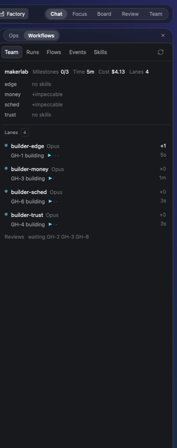

# Factory team view

Two tabs added to munza's Factory panel. Team shows the lane team that is running now: each lane, its builder, the issue it is on, the skills it reads, and which issues are due a review. Skills lets you change which of your Claude Code skills each group and each lane reads, without editing files.

## What you see

- The Factory panel's tab row: Team, Runs, Flows, Events, Skills. Below 500px wide the labels go short, counts drop and padding tightens so all five fit (checked at 413px).
- **Team**: the project name, milestones done over total, elapsed time and cost, then one row per lane: lane name, the builder's model, the issue it is building, issues left. Under the header, a skills strip with one line per lane, such as `ui  ui-ux-pro-max · shadcn · impeccable · +animate`. A group shows as its skills, a skill named alone gets a `+`, and the `always` group is left out. The line `review:` lists the issues due a review.
- **Skills**: one card per skill group with its title, `When: …` and about how many tokens the group adds (file bytes / 4). Each skill is a chip; hovering shows its size, `×` removes it. `+ Add` opens a search over installed skills not in the group, 8 matches at a time. A skill named in a group but not installed shows dimmed with the tooltip "Not installed".

## How it behaves

- Team finds live teams from `hc` terminals named `builder-*`. It uses the builder's folder (with any `.tsf/lanes/<lane>` part removed) or its Lead's. It prefers a team whose Lead is in the active space, then the active space's folder, then any live team, and shows the first with lanes or issues.
- Clicking a lane opens its `skills <lane>:` plan line as chips. `×` and `+ Add` edit that line in `.tsf/plan.md` through `skills.mjs lane`, then `hc send` the Lead `skills changed for lane <l>: <line>`. If no Lead is found or the send fails, the edit is kept and the panel says so.
- Group edits run `skills.mjs add|rm <group> <skill>`, which change `~/.config/herdr-app/data/orchestration/skills.json`.

## Built from

- munza's Factory mod (Apache-2.0, munza/herdr-mods at `6e2ffe0`, before Factory moved out of that repo).
- New files: `views/team.js`, `views/skills.js`, `run/skills.js` (calls `node <orchestration>/harness/skills/skills.mjs`), `run/skills.test.mjs`.
- `factory.patch` changes four upstream files: `main.js` (the two tabs and narrow-panel labels), `views/ui.js`, `views/workflows.js`, `actions/commands.js`.
- It reads the team feed from the herdr-team mod (`harness/lanes` and `status.mjs`) and runs `hc` and `node`.

## Watch out

- Needs Factory at that upstream version: `install.sh --ui` does a dry run of the patch first and changes nothing when it does not apply.
- Needs the herdr-team mod for the feed and `skills.mjs`.
- A builder still working after its lane worktree is removed does not show as a lane.
- A project with `.tsf/plan.md` and lanes but no live `builder-*` terminal is found only when it is the active space's folder.
- Removing a skill from a group edits your real `skills.json`.

## Done when

- `herdr-app check ~/.config/herdr-app/mods/factory` passes and `node run/skills.test.mjs` prints 3 passes.
- At about 413px wide all five tabs show.
- With a lane team running in another space, Team shows its lanes, the skills strip and the review line.
