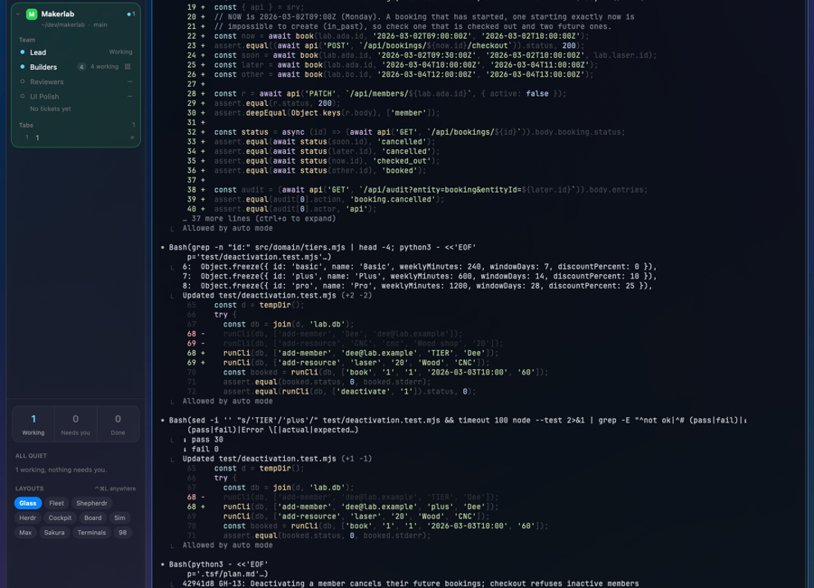

# Orchestration

A team of Claude Code sessions in one Herdr space. You press Start team and a Lead session opens, with its own tab, in the folder you are working in. A bar along the top shows the space name and the latest message sent between sessions. Two views sit below it: Sessions (the live terminals, with a header on each) and Tickets (the team along the top and a board of tickets under it). Only the Lead starts by default. Other seats start per ticket.

## What you see

- **Top bar (chain view), 12px side padding.** Left to right: the space name (12.5px); the last `hc send` message as `Sender → Receiver  text` in mono 11.5px, accent colored for 2.5s after it arrives, dim after; a Sessions / Tickets switch (24px high buttons, 12px text, active one has a `foreground + "24"` fill); a `Start team` button (accent fill) shown only while a non-on-demand seat is missing, reading `Start N more` when some already run; an `Exit  ⌘⇧O` button.
- **Sessions view.** The running agents as terminals in columns, each with a 34px-ish header bar (the middle of the header is 17px from the top). The header shows the seat's icon, role name, a status dot (7px) and the current note. A thin "spine" line runs between the columns.
- **Tickets view.** Row of seat chips (50px high, rounded 9px, one per `STATIONS` entry) with the tickets each holds. Below, columns from `COLUMNS` in `tickets.js`, each a rounded 12px panel with title, a count in mono, and up to 12 cards. Empty board text: "No tickets yet. Give the Lead a task and it will open them here."
- **Panel head.** A title bar for the right panel with a 22px close button (`mods/pane/close.svg`, 12px icon).
- **Drop squares.** Full-size squares shown only while a session header is dragged.

## How it behaves

- Status dot colors come from the theme (`t.working`, `t.blocked`, `t.done`, `t.idle`, else `t.dim`). A `working` dot pulses opacity 0.35 to 1 over 1200ms. A blocked ticket card has a `t.blocked` border and a "Blocked" tag. A new ticket card is highlighted (`t.accent`) for 4s.
- Messages: the mod polls `hc read` and detects `hc send` text. A message animates (1200ms) out of the sender header, down the spine, into the receiver header, which tints `accent + "26"`. At most 8 fly at once; the log keeps 60.
- Click a header: `pane.focus` that terminal. Drag a header more than 6px: drop squares appear, drop to place it in a slot. Each header has a close control, hidden when only one session shows.
- Start team writes a Herdr template for every seat (`~/.config/herdr-core/templates/<id>.md`, never over a file you wrote), then opens one tab per missing always-on seat with `tab.new`. A second click within 15s does not start a duplicate.
- Tickets view polls every 1.2s and syncs GitHub issues into tickets every 60s. Tickets move todo, doing, review, blocked, done.
- Sessions with subagents show them nested under their parent.

## Built from

- `mod.json`: `{ "place": "none", "title": "Orchestration" }`. `main.js` is one `View` class; `props().view` picks the part: `chain`, `spine`, `map`, `drop`, `panel-head`, or `props().terminal` for a session header.
- Commands (via `nextCommand`, text form): `start-team` (so `orchestration.start-team`), `view:sessions`, `view:tickets`, `place:<terminal>:<slot>`, `state` (publishes `orch.state` and writes `~/.config/herdr-app/orch-state.json`).
- Layout ids it expects: `orch-planes`, `orch-map`, `orch-body`, `panel`, `panel-body`. Shared keys: `orch.spaces`, `orch.state`, `orch.log`, `orch.packets`, `orch.drag`, `orch.frame`, `orch.tickets`.
- Herdr functions: `agents, exec, focused, layout, nextCommand, panes, props, run, setShared, shared, spaces, terminals, theme`; `run("tab.new" | "pane.focus" | "layout.select" | "layout.hide")`. UI from `gpui-kit` and `gpui-base`.
- Helper files: `team.js` (seats, launch), `tickets.js`, `events.js`, `activity.js`, `subagents.js`, `drop.js`, `grid.svg`. Tests: `*.test.mjs`.
- `team.js` seats. Shown on Start team: **Lead** (Opus 5.5, bare and lean, builds a code graph first). On demand: **UI Polisher** (Sonnet, small UI changes, proves with before-and-after), **Researcher** (Sonnet, no code changes, writes findings to a file). Crew, started with `hc run` or by `batch.mjs`: Backend (Opus), Worker (Sonnet medium, one ticket), Frontend (Opus), Test writer (Sonnet), Builder/factory (Opus 5.5 medium), lane-builder (Opus) and lane-builder-standard and factory-standard (Sonnet), worker-fast (Haiku), worker-strong (Opus 5.5 high), worker-codex (Codex gpt-6.1-sol medium), reviewer-light (Sonnet), reviewer-codex (Codex). Frozen seats kept for batch mode: builder, reviewer (Opus 5.5 high), planner (Opus 5.5).
- Each seat's duty is a prompt appended to `claude --append-system-prompt`. Lean seats get `--tools Bash,Read,Write,Edit,Agent --strict-mcp-config`; bare seats get `--setting-sources project,local --permission-mode auto`. Budgets: $0.50 and 10 min (Opus $1.50, 15 min).
- `HARNESS` knobs in `team.js` (workers, fixRounds, reviewRounds, test, suite, link, steal, floater, elastic, notes, readability, graph) are overridden by a project's `.tsf/settings.json`.
- `harness/` (no-token scripts unless noted):
  - `lanes/status.sh`: one line per lane worktree under `.tsf/lanes`, state, commits ahead, STALL and FREE flags (`status.mjs` for `--json`).
  - `lanes/ready.sh`: runs the verify command in a lane and lists files outside its globs; PASS records a handoff.
  - `lanes/land.sh`: merges one ready lane to main with `--no-ff`, runs tests, undoes on red.
  - `lanes/finish.sh`: runs the full test once and checks DONE.md commits are on main; prunes lanes.
  - `skills/skills.mjs`: which skills each lane loads, from `~/.config/herdr-app/data/orchestration/skills.json` (seeded by `default.json`).
  - `graph/auto.sh`: builds a Graphify code graph when `graphify` is on PATH and source is over 400 KB.
  - `capacity/capacity.sh`: prints how many more Workers fit in free memory (reserve 1536 MB, 400 MB each, max 8).
  - `batch/batch.mjs`: runs a `.tsf/batches/<id>.tsv` of tickets as Workers in a lane worktree; `LEAD-BATCH.md` is its Lead guide; `*-stub` files are test doubles.
  - `metrics/meter.mjs`: per-session cost and time from `~/.claude/projects` transcripts, read only.
  - `pulse/pulse.sh`: checks new GitHub issues, failing CI and stuck sessions, then `hc send` to the Lead.
  - `tickets/ticket.sh`: append-only ticket log per project (`add`, `issue`, `move`, `sync`, `ls`).
  - `summaries/summary.mjs`: one sentence per N tool calls from a transcript, written by a small Claude model.
  - `gate/gate.sh`: runs hidden tests for a gated ticket.
  - Each `prompt.js` is the section of Lead or seat prompt for that tool. Root `ticket.sh`, `capacity.sh`, `gate.sh` just forward to `harness/`.

## Watch out

- **It runs programs:** `hc`, `claude`, `codex` (for Codex seats), `git`, `gh`, `node`, `sh`, and `graphify` if installed. `main.js` runs `sh -c` with `$HOME/.local/bin/hc read` and `ticket.sh`.
- **It reads and writes outside its folder:** the project's `.tsf/` (`plan.md`, `traces/*.json`, `batches/`, `lanes/`, `settings.json`, `notes.md`), the project git repo and worktrees, `~/.claude/projects` transcripts, `~/.config/herdr-core/templates/`, `~/.config/herdr-app/orch-state.json` and `data/orchestration/skills.json`.
- **Network:** no direct HTTP calls. It reaches GitHub through `gh` (ticket sync every 60s, issue creation, pulse) and sessions reach the Anthropic API through `claude`. Without `gh` or a repo, tickets stay local.
- **Assumes:** Claude Code installed, skills in `~/.claude/skills` (the `tsf` skill from `packages/tsf` and skill packs from `packages/skill-packs`, e.g. `grilling`, `before-and-after`, `impeccable`), herdr-core `hc` at `~/.local/bin/hc`, and the mod installed at `~/.config/herdr-app/mods/orchestration` (paths are hard coded).
- **Shipped mod used:** `svg("mods/pane/close.svg")`. A Herdr build without `mods/pane` shows no close icon.
- The model ids (`claude-opus-5-5`, `gpt-6.1-sol`) must exist for your account; edit `team.js` otherwise.
- `team.js` prompts only ask. Nothing enforces one committer per ticket.
- `main.js` references layout ids and drop groups (Simulator, Web, Git, Trail, Blueprint, Ops, Workflows) from other mods; missing ones are filtered out.
- No `keys.json` ships; bind `orchestration.start-team` yourself. There is no preview.png in the folder yet.

## Done when

- `herdr-app check` passes for `mods/orchestration`.
- Command `orchestration.start-team` opens a "Lead" tab running `claude --model claude-opus-5-5` in the current folder, and the button then disappears.
- `orchestration.view:tickets` switches to the board; `view:sessions` switches back.
- `hc send` from one session to another shows an arrow line in the top bar and a message that travels the spine.
- `hc templates` lists the seats written by Start team.
- `node --test` on the `*.test.mjs` files passes; `sh harness/pulse/pulse.test.sh` passes.
